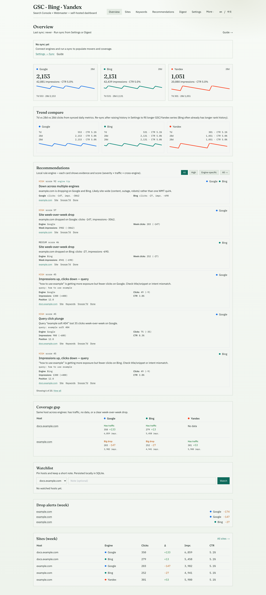
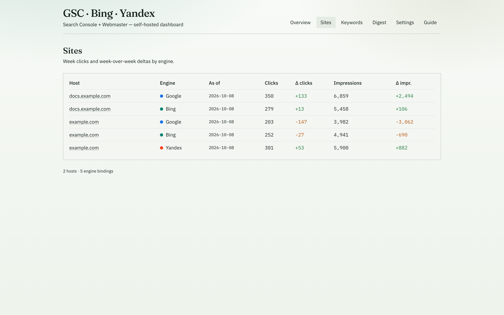
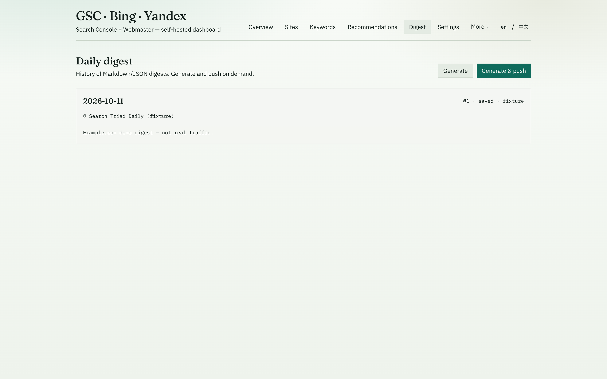
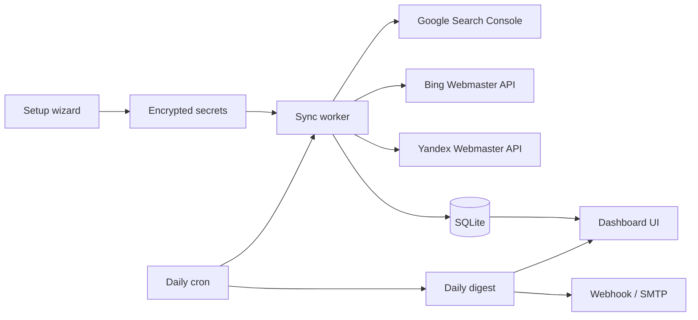

<p align="center">
  <strong>Search Triad</strong><br />
  Self-hosted SEO dashboard for Google Search Console, Bing Webmaster, and Yandex Webmaster
</p>

<p align="center">
  <a href="https://github.com/chainepic/search-triad/blob/main/LICENSE"></a>
  <a href="https://nodejs.org"></a>
  
  <a href="https://github.com/chainepic/search-triad"></a>
</p>

<p align="center">
  <a href="#quick-start">Quick start</a> ·
  <a href="#features">Features</a> ·
  <a href="#connect-search-engines">Connect engines</a> ·
  <a href="docs/zh/QUICKSTART.md">中文快速开始</a>
</p>

---

Search Triad is a **single-container, self-hosted panel** that pulls search performance from three webmaster APIs into one SQLite database. You get a setup wizard, live dashboards, keyword movers, and a **daily digest** (Markdown + JSON) pushed to Slack, Discord, or email.

No multi-tenant SaaS, no dependency on external SEO SaaS for GSC — credentials stay on your machine under `./data`.

### Screenshots

After you run the app, add captures under `docs/screenshots/` and wire them here:

- `docs/screenshots/overview.png` — Overview (7/28d engines + alerts)
- `docs/screenshots/sites.png` — Sites comparison table
- `docs/screenshots/digest.png` — Daily digest preview

```markdown



```

## Features

| Area | What you get |
| --- | --- |
| **Setup** | Four-step wizard; skip any engine (1–3 connected is fine) |
| **Overview** | 7 / 28-day clicks & impressions per engine, sparklines, cross-engine alerts |
| **Sites** | Side-by-side week clicks and week-over-week deltas |
| **Site detail** | Per-engine trends and top query gainers / losers |
| **Keywords** | Unified table: engine, host, clicks, impressions, position, Δ |
| **Digest** | History, preview, manual “generate & push” |
| **Schedule** | In-process cron (default **09:00** in your chosen timezone) |
| **Secrets** | OAuth tokens and API keys encrypted with `APP_SECRET` (AES-256-GCM) |

**Out of scope for v1:** GA4, Yandex Metrica, sitemap submission, multi-tenant hosting.

## Architecture



## Quick start

### Prerequisites

- [Node.js](https://nodejs.org/) 20+ and [pnpm](https://pnpm.io/) 9+
- Or [Docker](https://docs.docker.com/get-docker/) with Compose

### Local (recommended for first run)

```bash
git clone https://github.com/chainepic/search-triad.git
cd search-triad

pnpm install
cp .env.example apps/web/.env
```

Edit `apps/web/.env` and set **`APP_SECRET`** to a random string of at least 16 characters. This key encrypts stored API credentials.

```bash
pnpm dev
```

Open **http://localhost:3847/setup** and walk through environment → Google → Bing → Yandex. Each step can be skipped.

Production-style run after a build:

```bash
pnpm build
pnpm start
```

### Docker

```bash
cp .env.example .env
# Set APP_SECRET in .env
docker compose up --build
```

Open **http://localhost:3847/setup**. Database and `secrets.enc.json` are stored in the mounted **`./data`** directory.

### Demo data (UI only)

Fictional **example.com** metrics — no real API calls:

```bash
# With the app running and ALLOW_DEMO_SEED=1 in your env
curl -X POST http://localhost:3847/api/demo/seed
```

Use this to explore the UI before connecting live properties.

## Connect search engines

| Engine | Authentication | Setup notes |
| --- | --- | --- |
| **Google** | OAuth client (default) or service account JSON | Scope: `https://www.googleapis.com/auth/webmasters.readonly`. Redirect URI: `https://YOUR_HOST/api/oauth/google/callback` (local: `http://localhost:3847/api/oauth/google/callback`). Service accounts must be added as users on each GSC property. |
| **Bing** | API key from [Bing Webmaster Tools](https://www.bing.com/webmasters/) | Lists verified sites via the Webmaster API. |
| **Yandex** | OAuth app + access token | Scopes: `webmaster:hostinfo`, `webmaster:verify`. After browser auth, copy the token from the callback page into setup. |

You do **not** need all three. Many teams run Google + Bing only.

## Daily digest

1. Cron runs at the hour/minute you set in setup (default **09:00**, timezone e.g. `Asia/Shanghai`).
2. Sync pulls ~28 days of daily metrics and recent query movers into SQLite.
3. Core builds **JSON + Markdown** (account KPIs → site table → keyword movers).
4. Optional **webhook** (generic JSON POST) or **SMTP** delivery.
5. Every run is stored under **Digest** in the UI.

Trigger manually anytime from **Digest → Generate** or **Generate & push**.

## Project layout

```text
search-triad/
├── apps/web/              Next.js 15 app (UI + API routes + cron)
├── packages/connectors/   GSC, Bing, Yandex clients + movers
├── packages/core/         Digest builder + webhook helper
├── fixtures/              Sample digest JSON (example.com)
├── docs/zh/QUICKSTART.md  Chinese quick start
├── docker-compose.yml
├── data/                  SQLite + secrets (gitignored)
└── .env.example
```

## Configuration reference

| Variable | Required | Description |
| --- | --- | --- |
| `APP_SECRET` | Yes | Encrypts `data/secrets.enc.json` |
| `DATA_DIR` | No | Default: `./data` at repo root (Docker: `/data`) |
| `PORT` | No | Default `3847` |
| `TZ` | No | Container timezone hint; digest uses wizard timezone |
| `ALLOW_DEMO_SEED` | No | Set to `1` to enable `POST /api/demo/seed` |

## Development

```bash
pnpm lint          # Typecheck all packages
pnpm build         # connectors → core → web
pnpm dev           # dev server on :3847
```

See [CONTRIBUTING.md](CONTRIBUTING.md) for fork workflow and publishing a new GitHub repo.

## Security

- Generate a strong `APP_SECRET` **before** saving credentials in the wizard.
- Never commit `data/`, `.env`, or production API keys.
- Treat the panel like any admin tool: run behind VPN or reverse proxy with auth if exposed to the internet.

## License

[MIT](LICENSE) — use, modify, and self-host freely.

---

<p align="center">
  <sub>Built for teams who want one honest view of search performance across Google, Bing, and Yandex — without shipping keys to a third-party dashboard.</sub>
</p>
