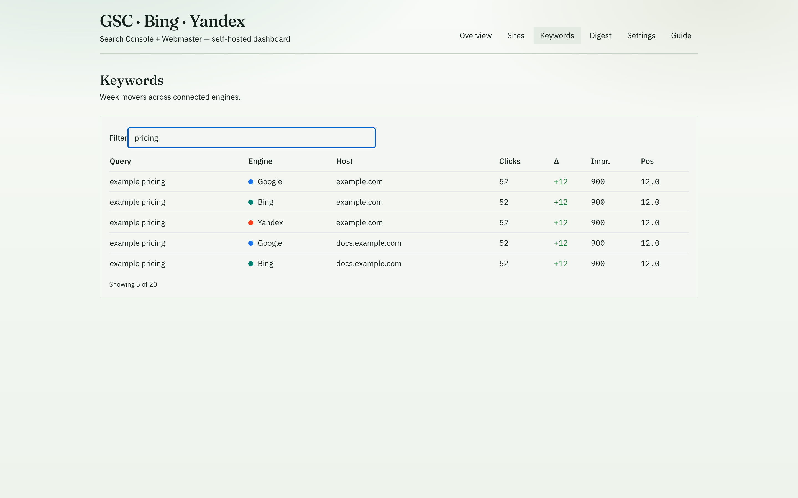
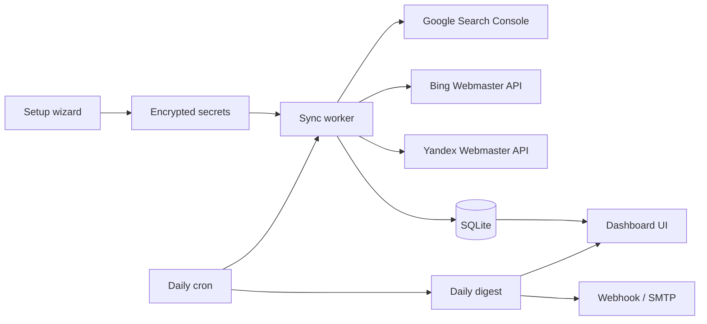

<p align="center">
  <strong>GSC · Bing · Yandex Dashboard</strong><br />
  Self-hosted panel for Google Search Console, Bing Webmaster Tools, and Yandex Webmaster
</p>

<p align="center">
  <a href="https://github.com/chainepic/gsc-bing-yandex-dashboard/blob/main/LICENSE"></a>
  <a href="https://nodejs.org"></a>
  
  
  
  <a href="https://github.com/chainepic/gsc-bing-yandex-dashboard"></a>
</p>

<p align="center">
  <a href="#screenshots">Screenshots</a> ·
  <a href="#quick-start">Quick start</a> ·
  <a href="#features">Features</a> ·
  <a href="#connect-search-engines">Connect engines</a> ·
  <a href="docs/zh/QUICKSTART.md">中文快速开始</a>
</p>

---

One SQLite database, three official webmaster APIs, zero third-party SEO SaaS for GSC. Connect **Google Search Console**, **Bing Webmaster**, and **Yandex Webmaster** (any subset), sync ~28 days of metrics, and get dashboards plus a **daily Markdown/JSON digest** via webhook or SMTP.

Credentials stay on your server in `./data` (encrypted with `APP_SECRET`).

## Screenshots

Demo UI with fictional **example.com** data (`ALLOW_DEMO_SEED=1`). Regenerate with `pnpm screenshots` while the app is running.

<p align="center">
  
</p>

<p align="center"><em>Overview — per-engine KPIs, sparklines, and cross-engine alerts</em></p>

<table>
  <tr>
    <td width="50%">
      
      <p align="center"><em>Sites — week clicks &amp; Δ by engine</em></p>
    </td>
    <td width="50%">
      
      <p align="center"><em>Site detail — engine tabs, trends, query &amp; page movers</em></p>
    </td>
  </tr>
  <tr>
    <td width="50%">
      
      <p align="center"><em>Keywords — unified movers table</em></p>
    </td>
    <td width="50%">
      
      <p align="center"><em>Keywords — client-side filter</em></p>
    </td>
  </tr>
  <tr>
    <td width="50%">
      
      <p align="center"><em>Daily digest — history, preview, generate &amp; push</em></p>
    </td>
    <td width="50%">
      
      <p align="center"><em>Settings — schedule, webhook, SMTP, sync</em></p>
    </td>
  </tr>
  <tr>
    <td width="50%">
      
      <p align="center"><em>Guide — onboarding checklist</em></p>
    </td>
    <td width="50%">
      
      <p align="center"><em>Setup wizard — connect engines</em></p>
    </td>
  </tr>
  <tr>
    <td width="50%">
      
      <p align="center"><em>First-run guidance</em></p>
    </td>
    <td width="50%">
      
      <p align="center"><em>SMTP digest delivery</em></p>
    </td>
  </tr>
</table>

## Features

| Area | What you get |
| --- | --- |
| **Setup** | Four-step wizard; skip any engine (1–3 connected is fine) |
| **Overview** | 7 / 28-day clicks & impressions per engine, sparklines, cross-engine alerts |
| **Sites** | Side-by-side week clicks and week-over-week deltas |
| **Site detail** | Per-engine trends and top query gainers / losers |
| **Keywords** | Unified table: engine, host, clicks, impressions, position, Δ |
| **Digest** | History, preview, manual “generate & push” |
| **Schedule** | In-process cron (default **09:00** in your chosen timezone) |
| **Secrets** | OAuth tokens and API keys encrypted with `APP_SECRET` (AES-256-GCM) |

**Out of scope for v1:** GA4, Yandex Metrica, sitemap submission, multi-tenant hosting.

## Architecture



## Quick start

### Prerequisites

- [Node.js](https://nodejs.org/) 20+ and [pnpm](https://pnpm.io/) 9+
- Or [Docker](https://docs.docker.com/get-docker/) with Compose

### Local

```bash
git clone https://github.com/chainepic/gsc-bing-yandex-dashboard.git
cd gsc-bing-yandex-dashboard

pnpm install
cp .env.example apps/web/.env
```

Set **`APP_SECRET`** in `apps/web/.env` (16+ random characters), then:

```bash
pnpm dev
```

Open **http://localhost:3847/setup**.

### Docker

```bash
cp .env.example .env
# Required: set a unique APP_SECRET (Compose refuses empty / placeholder defaults)
# Recommended for public hosts: also set PANEL_PASSWORD
APP_SECRET=$(openssl rand -hex 32) PANEL_PASSWORD='your-panel-password' docker compose up --build
```

Data persists in **`./data`**. Health probe: **`GET /api/health`** (no auth).

### Demo data

```bash
ALLOW_DEMO_SEED=1 curl -X POST http://localhost:3847/api/demo/seed
```

## Connect search engines

| Engine | Authentication | Setup notes |
| --- | --- | --- |
| **Google Search Console** | OAuth client (default) or service account JSON | Scope `webmasters.readonly`. Redirect: `https://YOUR_HOST/api/oauth/google/callback` |
| **Bing Webmaster** | API key | Verified sites via Webmaster API |
| **Yandex Webmaster** | OAuth + access token | Scopes `webmaster:hostinfo`, `webmaster:verify` |

## Daily digest

Cron → sync → SQLite → JSON + Markdown → optional webhook/SMTP → **Digest** in UI. Default **09:00** in wizard timezone (e.g. `Asia/Shanghai`).

## Project layout

```text
gsc-bing-yandex-dashboard/
├── apps/web/              Next.js 15 (UI + API + cron)
├── packages/connectors/   GSC, Bing, Yandex clients
├── packages/core/         Digest builder
├── docs/screenshots/      README product captures
├── docs/zh/QUICKSTART.md
└── docker-compose.yml
```

## Development

```bash
pnpm lint
pnpm build
pnpm dev
```

## Security

- Strong unique `APP_SECRET` before saving credentials (Docker entrypoint rejects empty / example placeholders)
- Optional panel **Basic Auth** — set `PANEL_PASSWORD` (user `admin`) or `BASIC_AUTH_USER` + `BASIC_AUTH_PASSWORD`. When unset, the app stays open for localhost/LAN. When set, the whole UI and API are gated (except `/api/health`)
- Never commit `data/`, `.env`, or production keys
- Prefer VPN **or** reverse-proxy auth in front of the panel on the public internet

### Reverse proxy (optional)

Terminate TLS and/or add another auth layer in front of port `3847`:

**Caddy**

```caddy
panel.example.com {
  reverse_proxy 127.0.0.1:3847
  # basicauth is optional if PANEL_PASSWORD is already set in the app
}
```

**nginx**

```nginx
location / {
  proxy_pass http://127.0.0.1:3847;
  proxy_set_header Host $host;
  proxy_set_header X-Forwarded-For $proxy_add_x_forwarded_for;
  proxy_set_header X-Forwarded-Proto $scheme;
  # auth_basic "Search Triad";
  # auth_basic_user_file /etc/nginx/htpasswd;
}
```

Smoke check: `pnpm test:smoke` (add `BASE_URL=http://127.0.0.1:3847` for a live probe).

## License

[MIT](LICENSE)
